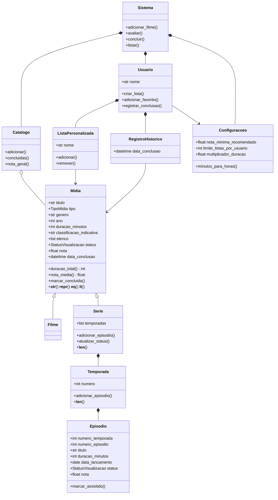

# Catálogo de Filmes e Séries

Projeto 1 de POO (UFCA - Eng. de Software) - Tema 10.

## Sobre o projeto

A ideia é um CLI pra gerenciar um catálogo pessoal de filmes e séries.
Dá pra cadastrar mídias, acompanhar temporadas e episódios de séries,
avaliar (nota de 0 a 10), ver histórico de visualização, criar listas
tipo "favoritos" ou "pra assistir", e tirar relatórios (nota média por
gênero, tempo total assistido, top 10, etc).

O foco do trabalho é aplicar POO de verdade: herança (Midia -> Filme/Serie),
composição (Serie tem Temporadas, Temporada tem Episodios), encapsulamento
com `@property` pras validações, e os métodos especiais pedidos (`__str__`,
`__repr__`, `__eq__`, `__len__`, `__lt__`).

A persistência é em JSON via `dados.py` (pasta `dados/`), e as configurações
ficam no `settings.json`.

## Estrutura do projeto

```
.
├── README.md
├── settings.json
├── pytest.ini                # configuração do pytest
├── dados/                    # catalogo.json e usuario.json (criados no 1º uso)
├── testes
│   └── test_catalogo.py      # testes com pytest
└── src
    ├── cli.py                    # CLI com subcomandos (ponto de entrada)
    ├── menu.py                   # menu interativo (abre com `python -m src.cli`)
    ├── models                    # as classes do domínio
    │   ├── enums.py              # TipoMidia, StatusVisualizacao
    │   ├── midia.py              # Midia (base)
    │   ├── filme.py              # Filme
    │   ├── serie.py              # Serie
    │   ├── temporada.py          # Temporada
    │   ├── episodio.py           # Episodio
    │   ├── usuario.py            # Usuario
    │   ├── lista_personalizada.py
    │   └── registro_historico.py
    ├── services                  # regras de negócio
    │   ├── sistema.py            # Sistema: fachada usada pela CLI e pelo menu
    │   ├── catalogo.py           # Catalogo: guarda mídias, impede duplicidade
    │   └── relatorios.py         # relatórios do catálogo
    ├── persistence
    │   └── dados.py              # salvar/carregar (JSON) e seed
    ├── config
    │   └── configuracoes.py      # Configuracoes: lê o settings.json
    └── utils
        └── validacoes.py         # funções de validação usadas nos setters
```

Cada pasta tem uma responsabilidade: `models` só tem classes do domínio,
`services` as regras que envolvem várias mídias, `persistence` o acesso a
arquivo, `config` as configurações e `utils` funções de apoio.

## Estrutura de classes

| Classe | Papel |
|---|---|
| `Midia` | classe base de filmes e séries |
| `Filme` | herda de Midia, fixa tipo FILME |
| `Serie` | herda de Midia, agrega Temporadas, nota e duração calculadas |
| `Temporada` | agrupa Episodios de uma Serie |
| `Episodio` | unidade assistível de uma Serie, com nota opcional |
| `Usuario` | dono das listas personalizadas e do histórico |
| `ListaPersonalizada` | lista nomeada de mídias ("Favoritos", "Pra assistir") |
| `RegistroHistorico` | data/hora de conclusão de uma mídia |
| `Catalogo` | coleção de mídias; garante que não haja duplicidade |
| `Sistema` | fachada: junta Catalogo, Usuario e Configuracoes; a CLI só chama ele |
| `Configuracoes` | parâmetros do `settings.json` |
| `TipoMidia`, `StatusVisualizacao` | enums do domínio |

## UML textual

```
ENUMS

TipoMidia:            FILME | SERIE
StatusVisualizacao:   NÃO ASSISTIDO | ASSISTINDO | ASSISTIDO


CLASSES

Midia
  atributos:
    - titulo: str                       (não vazio)
    - tipo: TipoMidia                   (só leitura)
    - genero: str
    - ano: int                          (>= 1888)
    - duracao_minutos: int | None       (> 0; None em Serie)
    - classificacao_indicativa: str
    - elenco: list[str]
    - status: StatusVisualizacao
    - nota: float | None                (0 a 10)
    - data_conclusao: datetime | None
  métodos:
    + duracao_total() -> int            Filme: a própria; Serie: soma dos episódios
    + nota_media() -> float | None      Serie sobrescreve
    + marcar_concluida(quando)
    + __str__() / __repr__()
    + __eq__(other)                     compara por titulo + tipo
    + __hash__()                        coerente com o __eq__
    + __lt__(other)                     compara por nota média

Filme (herda de Midia)
  atributos: nenhum extra (tipo fixo em FILME, duração obrigatória)
  métodos: nenhum extra

Serie (herda de Midia)
  atributos:
    - temporadas: list[Temporada]       (tipo fixo em SERIE; só leitura)
    - nota: float | None                (só leitura = nota_media())
  métodos:
    + adicionar_temporada(temporada)
    + adicionar_episodio(episodio)      cria a temporada se ainda não existir
    + todos_episodios() -> list[Episodio]
    + episodios_assistidos() -> int
    + duracao_total() -> int            soma dos episódios
    + nota_media() -> float | None      média das notas dos episódios
    + atualizar_status()                vira ASSISTIDO quando todos os episódios forem
    + marcar_concluida(quando)          marca todos os episódios
    + __len__()                         total de episódios

Temporada
  atributos:
    - numero: int                       (> 0)
    - episodios: list[Episodio]         (só leitura)
  métodos:
    + adicionar_episodio(episodio)      não aceita número repetido
    + duracao_total() -> int
    + todos_assistidos() -> bool
    + __len__()                         número de episódios da temporada

Episodio
  atributos:
    - numero_temporada: int             (> 0)
    - numero_episodio: int              (> 0)
    - titulo: str                       (não vazio)
    - duracao_minutos: int              (> 0)
    - data_lancamento: date
    - status: StatusVisualizacao
    - nota: float | None                (0 a 10, opcional)
    - data_conclusao: datetime | None
  métodos:
    + marcar_assistido(quando)
    + __str__() / __repr__()

Usuario
  atributos:
    - nome: str
    - configuracoes: Configuracoes
    - listas: list[ListaPersonalizada]
    - historico: list[RegistroHistorico]
  métodos:
    + criar_lista(nome)                 respeita o limite do settings.json
    + obter_lista(nome)
    + adicionar_favorito(midia, nome_lista)
    + registrar_conclusao(midia)

ListaPersonalizada
  atributos:
    - nome: str
    - midias: list[Midia]
  métodos:
    + adicionar(midia)
    + remover(midia)
    + __len__()

RegistroHistorico
  atributos:
    - midia: Midia
    - data_conclusao: datetime
  métodos:
    + __str__()

Catalogo
  atributos:
    - midias: list[Midia]
  métodos:
    + adicionar(midia)                  recusa duplicidade (titulo + tipo + ano)
    + existe(titulo, tipo, ano) -> bool
    + buscar(titulo, tipo) -> list[Midia]
    + concluidas() -> list[Midia]       só status ASSISTIDO
    + nota_geral() -> float | None
    + __len__()

Configuracoes
  atributos:
    - nota_minima_recomendado: float
    - limite_listas_por_usuario: int
    - multiplicador_duracao: float      minutos -> horas
    - casas_decimais_horas: int         arredondamento
  métodos:
    + carregar(caminho)                 (classmethod, lê o settings.json)
    + minutos_para_horas(minutos) -> float


RELACIONAMENTOS

Filme  --herda--> Midia
Serie  --herda--> Midia

Serie     <>-- Temporada           composição (1 série tem 0..* temporadas)
Temporada <>-- Episodio            composição (1 temporada tem 0..* episódios)
Usuario   <>-- ListaPersonalizada  composição (1 usuário tem 0..* listas)
Usuario   <>-- RegistroHistorico   composição (1 usuário tem 0..* registros)
Catalogo  <>-- Midia               agregação  (1 catálogo tem 0..* mídias)

Sistema   <>-- Catalogo, Usuario, Configuracoes   composição (a fachada usa os três)

ListaPersonalizada  --> Midia          associação (uma lista referencia 0..* mídias)
RegistroHistorico   --> Midia          associação (um registro referencia 1 mídia)
Usuario             --> Configuracoes  associação (usa o limite de listas)
```

`<>--` é o losango (o "todo" fica do lado do losango) e `-->` é associação
simples.

## Diagrama de classes



## Rodando

Na raiz do projeto (Python 3.10 ou mais novo). Na primeira execução o catálogo
é criado com filmes e séries de exemplo (seed) na pasta `dados/`.

### Menu interativo

```bash
python -m src.cli
```

Sem nenhum comando depois, abre um menu: digite o número da opção e siga as
perguntas (`0` sai). Também dá pra abrir com `python -m src.menu`.

### Subcomandos

```bash
python -m src.cli midia adicionar --titulo "Matrix" --tipo FILME --genero Ficcao --ano 1999 --duracao 136 --classificacao 14
python -m src.cli midia avaliar --titulo "Interestelar" --nota 9
python -m src.cli midia listar --por-nota
python -m src.cli midia relatorio top

python -m src.cli serie adicionar-episodio --serie "Dark" --temporada 1 --episodio 2 --titulo "Mentiras" --duracao 50 --lancamento 2017-12-08
python -m src.cli serie atualizar-status --serie "Dark" --temporada 1 --episodio 1 --status ASSISTIDO

python -m src.cli usuario criar-lista --nome "Maratona"
python -m src.cli usuario adicionar-favorito --titulo "Interestelar" --lista "Maratona"
```

Outros: `midia detalhes`, `midia concluir`, `midia atualizar-status`,
`midia relatorio generos | tempo | series | periodo | completo`,
`serie episodios`, `usuario listas | remover | historico` e
`seed --forcar` (apaga os dados e recria o exemplo).
Use `--help` em qualquer comando, por exemplo `python -m src.cli midia --help`.

### Testes

```bash
python -m pip install pytest
pytest -v          # ou: python -m pytest -v
```

Os testes cobrem validações, métodos especiais, status automático da série,
nota média, duplicidade, listas e favoritos, relatórios e persistência.

## Decisões de implementação

- O `Sistema` concentra as regras de negócio; `cli.py` e `menu.py` só leem a
  entrada, chamam o `Sistema` e mostram o resultado.
- Só dá pra avaliar o que já foi assistido; a nota da série é a média das
  notas dos episódios.
- O status da série é calculado pelos episódios (todos assistidos = ASSISTIDO).
- Relatórios consideram só mídias com status ASSISTIDO, inclusive a nota
  geral do catálogo. Exceção: o ranking de séries mais assistidas inclui
  séries em andamento, e o relatório de período conta episódio por episódio.
- Erros de regra viram `Erro: ...` com código de saída 1, sem mostrar traceback.

## Onde estou (semana 5 - entrega final)

- [x] estrutura de classes, UML textual e diagrama de classes
- [x] `Midia`, `Filme`, `Serie`, `Temporada` e `Episodio` com validações (`@property`) e métodos especiais
- [x] `Usuario`, `ListaPersonalizada`, `RegistroHistorico`, `Catalogo` e `Sistema`
- [x] persistência em JSON e seed
- [x] status automático da série e cálculo de médias
- [x] listas personalizadas e favoritos
- [x] CLI com subcomandos e menu interativo
- [x] testes com pytest
- [x] relatórios (nota por gênero, tempo por tipo, top, séries mais assistidas, por semana/mês)
- [x] refinamento e diagrama final
- [ ] tag `v1.0` no GitHub (`git tag v1.0 && git push origin v1.0`)